# Hey, I'm Aryan 👋

Hands-on CTO and founding engineer building web, mobile and AI products.

I lead engineering at **PortzApp**, from product architecture and implementation to cloud infrastructure and releases. My work includes modernizing a legacy SaaS application, building a tool-calling AI assistant, and automating engineering workflows.

Previously, I led **Trilogy Health's** mobile app rebuild and launch, and helped build **Parabola9's** customer-facing dashboard and agentic AI workflows.

[Portfolio](https://aryanprince.com) · [LinkedIn](https://www.linkedin.com/in/aryanprince/) · [Email](mailto:hello@aryanprince.com)

## Things I’ve built

- **[Skill Sync](https://github.com/aryanprince/skill-sync)**: a native macOS menu bar app for organizing coding-agent skills and MCP servers.
- **[svgl-react](https://github.com/aryanprince/svgl-react)**: a React component library for SVG logos from SVGL.
- **[create-docker-db](https://github.com/aryanprince/create-docker-db)**: a CLI for scaffolding local databases with Docker Compose.
- **[Campus Hub](https://github.com/aryanprince/campus-hub)**: a university management project with independently deployed services in a Next.js monorepo.
- **[UniTrack](https://github.com/UniTrackApp/dashboard)**: an attendance dashboard connected to RFID-based tracking.

## Tools I work with

**Web and mobile**

**Data and infrastructure**

**Quality and observability**

## GitHub activity

